  

# Awesome Financial General Ledger & Accounting Journal 📊 📑 ⚖️

  
  
  
  
  
  
  

---

## 🌟 Top Financial General Ledger & Accounting Journal Ecosystem

> **Curated Directory of Cloud SaaS Accounting Suites & Open-Source Double-Entry Ledger Engines**  
> *Focused on General Ledger (GL), Chart of Accounts (COA), Journal Vouchers, Multi-Entity Consolidation, Audit Trails & Plain-Text Accounting (PTA)*  
> 📅 **Last updated: March 2026**

This repository is an SEO-optimized, industry-standard directory tracking the premier **SaaS financial platforms** and **open-source GitHub software** for **Financial General Ledger, Double-Entry Bookkeeping, and Accounting Journals**. Whether you are evaluating enterprise ERP solutions like Oracle NetSuite and Microsoft Dynamics 365, SMB cloud suites like QuickBooks Online and Xero, or seeking self-hosted ledger engines with complete data sovereignty (such as ERPNext, Odoo, GnuCash, LedgerSMB, Beancount, or dubbl), this guide delivers accurate pricing benchmarks, free trial limits, valuation metrics, and architectural tradeoffs.

---

## 📑 Table of Contents
- [🔍 Sector Overview & Market Dynamics](#-sector-overview--market-dynamics)
- [☁️ SaaS / Hosted Financial Platforms](#️-saas--hosted-financial-platforms)
- [💻 Open-Source GitHub Projects](#-open-source-github-projects)
- [🛠️ Frameworks for Building Custom Financial Infrastructure](#️-frameworks-for-building-custom-financial-infrastructure)
- [🤝 How to Contribute](#-how-to-contribute)
- [☕ Support & Sponsorship](#-support--sponsorship)
- [📈 Star History](#-star-history)
- [⚠️ Disclaimer](#️-disclaimer)

---

## 🔍 Sector Overview & Market Dynamics

The global accounting software market is valued at approximately **$20.8B to $23.5B (2025–2026)** and is projected to expand beyond **$35B–$50B by the early 2030s** at a compound annual growth rate (CAGR) of 7.5%–10.2%. 

The sector exhibits a **moderately consolidated structure at the top**—dominated by mega-cap technology and ERP incumbents including Microsoft Dynamics, Oracle NetSuite, Intuit QuickBooks, Sage, and Xero, which collectively account for over 50% of global market share. Conversely, the market remains **heavily fragmented across the long tail**, driven by localized statutory tax requirements, regional electronic invoicing mandates (such as Peppol, ZUGFeRD, XRechnung, and SAF-T), and specialized vertical requirements across mid-market and small-to-medium enterprises.

---

## ☁️ SaaS / Hosted Financial Platforms

| Product 🏢 | Company Size (Valuation / Revenue) 🌐 | Pricing (Starting) 💳 | Free Tier / Trial Limits ⏳ | Description 📖 |
|:---|:---|:---|:---|:---|
| **[Microsoft Dynamics 365 Business Central](https://dynamics.microsoft.com/en-us/business-central/overview/)** | **~$3.89 Trillion Market Cap** (~$340B+ Revenue) | **$80/user/month** (Essentials edition, billed annually) | **30-day free trial**; includes sample company database or custom data evaluation environment. | **Mid-market ERP with integrated financials.** General ledger, bank reconciliation, fixed assets, and financial reporting natively tied into the Microsoft 365 ecosystem. |
| **[NetSuite](https://www.netsuite.com/)** | **~$390 Billion Market Cap** (~$67.4B Revenue, parent Oracle) | **~$999/month base platform fee + $129–$199/user/month** (typically $25,000–$50,000+/year contract) | **No self-serve free trial**; access is via custom guided sales demo and tailored sandbox proof-of-concept (POC). | **ERP with full general ledger and accounting.** Multi-currency, multi-subsidiary consolidation (OneWorld), automated journal entries, and advanced revenue recognition. |
| **[QuickBooks Online](https://quickbooks.intuit.com/)** | **~$91 Billion Market Cap** (~$21.4B Revenue, Intuit) | **$38/month** (Simple Start tier; $85/mo Essentials, $140/mo Plus) | **Free Forever plan** (capped at 2 invoices/mo & 1 bank connection); or **30-day free trial** of paid plans with full feature access. | **The SMB accounting standard.** Double-entry bookkeeping, automated bank feeds, invoicing, expense tracking, and extensive third-party app integrations. |
| **[Workday Financials](https://www.workday.com/)** | **~$46 Billion Market Cap** (~$10B Revenue) | **~$100,000–$200,000+/year** (contract floor tiered by organization FSE & user volume) | **No self-serve free trial**; access is limited to custom vendor architectural evaluations and enterprise guided demos. | **Enterprise financial management.** Global general ledger, accounting, audit tracking, and real-time financial reporting unified with the Workday HCM suite. |
| **[Zoho Books](https://www.zoho.com/books/)** | **~$12.5 Billion Valuation** (~$1.5B Revenue, Zoho Corp) | **$15/organization/month** (Standard plan, billed annually; $20/mo billed monthly) | **Free Forever plan** (for businesses under $50K annual revenue, capped at 1 user + 1 accountant, 1,000 invoices/year); or **14-day free trial** of paid tiers. | **Accounting within the Zoho ecosystem.** Double-entry, invoicing, automated bank feeds, expense tracking, and native integration with Zoho CRM and Inventory. |
| **[Sage Intacct](https://www.sageintacct.com/)** | **~$13 Billion Market Cap** (~$3.3B Revenue, Sage Group) | **~$8,500–$11,000/year** (Core financial management starting package) | **30-day guided free trial**; provisioned with a pre-configured sample company environment and partner demo assistance. | **Enterprise-grade general ledger for mid-market.** Multi-entity consolidation, dimensional chart of accounts reporting, gap-free audit trails, and automated revenue recognition. |
| **[Xero](https://www.xero.com/)** | **~$9.5 Billion Market Cap** (~$1.75B Revenue) | **$27/month** (Early tier; $59/mo Growing, $97/mo Established) | **30-day free trial** with full feature access; Early plan is strictly capped at 20 invoices/quotes and 5 bills per month. | **Cloud accounting for small businesses.** Double-entry bookkeeping, unlimited users across all tiers, bank reconciliation, invoicing, and a large app marketplace. |
| **[Acumatica](https://www.acumatica.com/)** | **~$2 Billion Valuation** (Acquired by Vista Equity Partners) | **~$5,400–$7,000/year** (Essentials edition base resource tier) | **No self-serve free trial**; access requires a customized partner-led demonstration with sample company datasets. | **Cloud ERP with consumption-based resource pricing.** General ledger, AP/AR, multi-currency, and financial reporting with unlimited user licenses. |

---

## 💻 Open-Source GitHub Projects

| Project 📦 | Stars_Badge ⭐ | Description 📝 |
|:---|:---:|:---|
| **[Odoo Community](https://github.com/odoo/odoo)** |  | **The most widely adopted open-source ERP globally.** **LGPL-3.0**, Python/PostgreSQL. **Accounting module** with double-entry, bank reconciliation, invoicing, and multi-currency. **Trade-off**: Advanced accounting features (analytic accounting, advanced reporting) are reserved for the paid Enterprise edition. **Best for organizations wanting maximum ecosystem breadth** and a modular approach. |
| **[ERPNext](https://github.com/frappe/erpnext)** |  | **Full-featured 100% open-source ERP with deep general ledger accounting.** **GPL-3.0**, Python/Frappe framework/MariaDB. Native **double-entry general ledger**, chart of accounts, journal vouchers, accounts payable/receivable, multi-currency, multi-company consolidation, budgeting, bank reconciliation, and customizable financial statements. **Best for growing companies needing complete ERP financial management** without proprietary license locks. |
| **[Actual](https://github.com/actualbudget/actual)** |  | **100% local-first, privacy-focused open-source budget and ledger management system.** **MIT licensed**, TypeScript/Node/SQLite. Provides envelope budgeting, zero-based account tracking, bank sync via SimpleFIN/GoCardless, and end-to-end encryption with optional self-hosted sync server. **Best for personal and micro-business ledger tracking** with absolute data ownership. |
| **[Firefly III](https://github.com/firefly-iii/firefly-iii)** |  | **Self-hosted double-entry financial manager and personal ledger.** **AGPL-3.0**, PHP/Laravel. Enforces double-entry bookkeeping across asset accounts, expense accounts, revenue accounts, and liabilities. Includes rule-based automated transaction categorization, recurring budgets, multi-currency, and comprehensive reporting. **Best for individuals and solopreneurs wanting a strict, self-hosted double-entry ledger**. |
| **[Akaunting](https://github.com/akaunting/akaunting)** |  | **Web-based open-source accounting for small businesses and freelancers.** **GPL-3.0** (core), PHP/Laravel. The self-hosted on-premise version includes core double-entry bookkeeping, unlimited invoicing, expense tracking, and bill management. **Modular app store** layout provides plug-and-play extensions. **Best for teams wanting a modern web UI** with core accounting and optional modular add-ons. |
| **[Beancount](https://github.com/beancount/beancount)** |  | **Double-entry bookkeeping computer language in plain text.** **GPL-2.0**, Python. Defines transactions, assets, liabilities, and equity in human-readable text files with strict double-entry balance validation. Accompanied by the popular web UI Fava for rich reporting, balance sheets, and interactive journal inspection. **Best for engineers and technical users wanting audit-grade text-based accounting**. |
| **[Ledger](https://github.com/ledger/ledger)** |  | **The original command-line double-entry accounting tool.** **BSD-3-Clause**, C++. Processes plain-text journal files without modifying input data, generating balance reports, register queries, and income statements at blazing speed. Inspired an entire ecosystem of plain-text accounting software. **Best for CLI power users and scriptable financial pipelines**. |
| **[Frappe Books](https://github.com/frappe/books)** |  | **Clean, offline desktop accounting for freelancers and small businesses.** **AGPL-3.0**, Electron/Vue. Works completely offline, storing records locally in SQLite. Supports double-entry bookkeeping, journal entries, invoices, payments, and basic inventory tracking. **Best for solopreneurs and small teams** wanting a simple, well-designed desktop app without hosting or server requirements. |
| **[hledger](https://github.com/simonmichael/hledger)** |  | **Robust plain-text double-entry accounting with version control.** **GPL-3.0**, Haskell. Human-readable plain-text journal files tracking money, investments, invoices, and time with full Git history and privacy. Features multiple UIs (CLI, TUI terminal, and web interface), processing over 25k transactions per second. **Best for developers and power users** wanting future-proof, scriptable books under version control. |
| **[GnuCash](https://github.com/Gnucash/gnucash)** |  | **The most widely used open-source desktop accounting application.** **GPL-2.0+**, C/C++/Scheme. Genuine double-entry general ledger with full chart of accounts (assets, liabilities, equity, income, expenses) and nested subaccounts. Features invoicing, bill payment, tax tables, bank statement import (QIF, OFX, HBCI/FinTS), and lot-level investment tracking. **Best for small businesses and individuals** wanting a battle-tested desktop ledger with full control over data. |
| **[LedgerSMB](https://github.com/ledgersmb/LedgerSMB)** |  | **The most complete open-source double-entry ERP and accounting system.** **GPL-2.0 licensed**, with a lineage going back two decades as the maintained fork of SQL-Ledger. Full order-to-cash and procure-to-pay cycle: quotations, orders, invoicing, payments, inventory, fixed assets, budgeting, and bank reconciliation. Features a complete general ledger and REST interface. **Best for SMBs needing a proven, full-featured accounting ERP** without licensing fees. |
| **[dubbl](https://github.com/dubbl-org/dubbl)** |  | **Modern API-first open-source Xero/QuickBooks alternative.** **Apache-2.0 licensed**, Next.js/PostgreSQL. Complete double-entry bookkeeping with chart of accounts, journal entries, and bank reconciliation. Invoicing, quotes, bills, POs, 25+ financial reports, multi-currency, and a full REST API with a built-in MCP server for AI agents. **Best for teams wanting a modern, developer-friendly self-hosted platform** with AI integration and zero per-seat fees. |
| **[OpenBusinessERP](https://github.com/datadrivenconstruction/OpenBusinessERP)** |  | **Self-hosted ERP with strong European accounting compliance.** **MIT licensed**, 44 interface languages, 79 currencies, and e-invoicing (EN 16931, Peppol BIS, XRechnung, ZUGFeRD). Features accountant exports (SAF-T 2.0, DATEV EXTF), immutable posted entries, locked periods, and audit logging. **Best for European SMBs** needing electronic invoicing and standardized accounting export. |

---

## 🛠️ Frameworks for Building Custom Financial Infrastructure

- **For Enterprise Resource Planning (ERP):** Choose **[ERPNext](https://github.com/frappe/erpnext)** or **[LedgerSMB](https://github.com/ledgersmb/LedgerSMB)** for full-cycle order-to-cash, inventory, and automated journal reconciliation.
- **For Modern API & AI Agent Integration:** Choose **[dubbl](https://github.com/dubbl-org/dubbl)** for RESTful endpoints, Next.js architecture, and built-in Model Context Protocol (MCP) server support.
- **For Desktop Bookkeeping & Investments:** Choose **[GnuCash](https://github.com/Gnucash/gnucash)** or **[Frappe Books](https://github.com/frappe/books)** for localized, offline-first ledger tracking without server overhead.
- **For Scriptable & Plain-Text Accounting (PTA):** Choose **[Beancount](https://github.com/beancount/beancount)**, **[hledger](https://github.com/simonmichael/hledger)**, or **[Ledger](https://github.com/ledger/ledger)** for Git-backed audit histories and scriptable programmatic reporting.

---

## 🤝 How to Contribute

Contributions are welcome and appreciated! Help keep this financial accounting directory fresh, accurate, and comprehensive:

1. 🍴 **Fork the repository** to your own GitHub account.
2. 🌿 **Create a feature branch**: `git checkout -b feature/add-new-ledger-tool`.
3. ✏️ **Add or update entries in `README.md`**: Follow the established table schemas, ensuring specific starting pricing, factual capabilities, and proper stargazer link badges.
4. 🚀 **Commit your changes**: `git commit -m "Add [Tool Name] with pricing and feature overview"`.
5. 📬 **Submit a Pull Request** with a concise description of why the tool is suitable for general ledger or accounting workflows.

⭐ **Don't forget to star the repository if you found it useful!**

---

## ☕ Support & Sponsorship

Thank you for exploring and utilizing this curated directory! Maintaining up-to-date benchmarks on financial software, licensing frameworks, and open-source ledger developments requires continuous research.

If you find this list helpful for your accounting infrastructure, engineering projects, or finance workflows, please consider supporting the project:

- ⭐ **Star this repository** to improve visibility for the open-source community.
- 🍴 **Fork and share** with fellow developers, accountants, and finance teams.
- ☕ **Sponsor the maintainer / Buy a coffee**: Support ongoing open-source curation and development via the [GitHub Sponsors Dashboard](https://github.com/sponsors/ishandutta2007).

Your generosity and community engagement keep this resource completely free, open, and actively maintained! 🙌

---

## 📈 Star History

---

## ⚠️ Disclaimer

- This repository is a **community-curated directory** provided for educational and informational purposes only — it does not constitute an endorsement, professional accounting advice, or financial auditing counsel.
- General ledger and accounting platforms maintain records subject to strict regulatory oversight and statutory compliance; always enforce rigorous access controls, immutable audit trails, and ensure compliance with relevant standards (such as US GAAP, IFRS, or local tax authorities).
- **Open-source software trade-offs**: Verify architectural suitability before production deployment. While **ERPNext** and **LedgerSMB** provide comprehensive enterprise ERP workflows, they require infrastructure maintenance; **dubbl** provides modern API and AI connectivity with a newer codebase; **GnuCash** offers battle-tested desktop stability with a steeper configuration curve; and **plain-text accounting engines** prioritize scriptability and version control over GUI accessibility.

---

  <b>Built with care for finance teams, accountants, and developers building general ledger infrastructure.</b> 
  Let's make financial accounting engines transparent, auditable, and cost-predictable. 🚀

